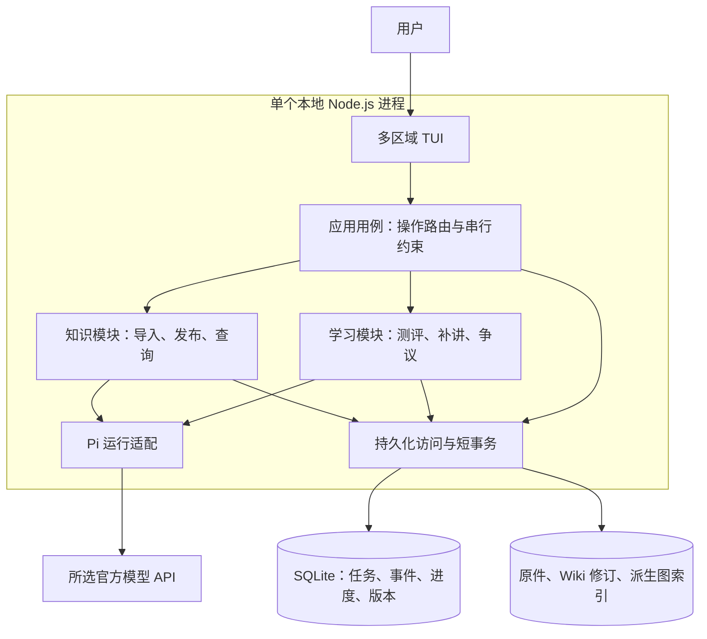
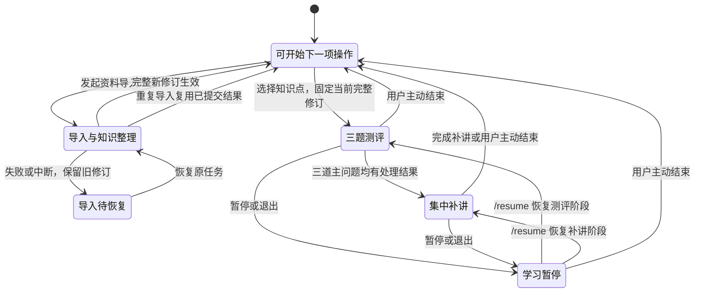
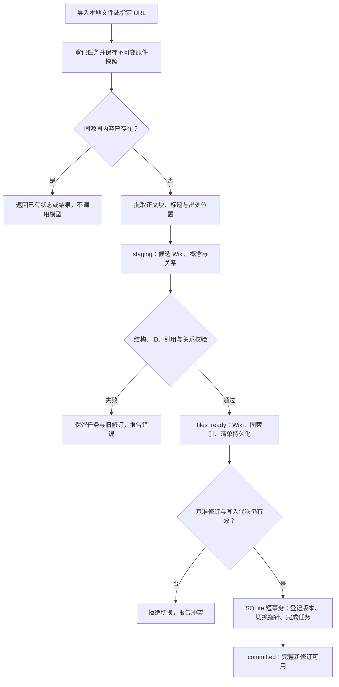
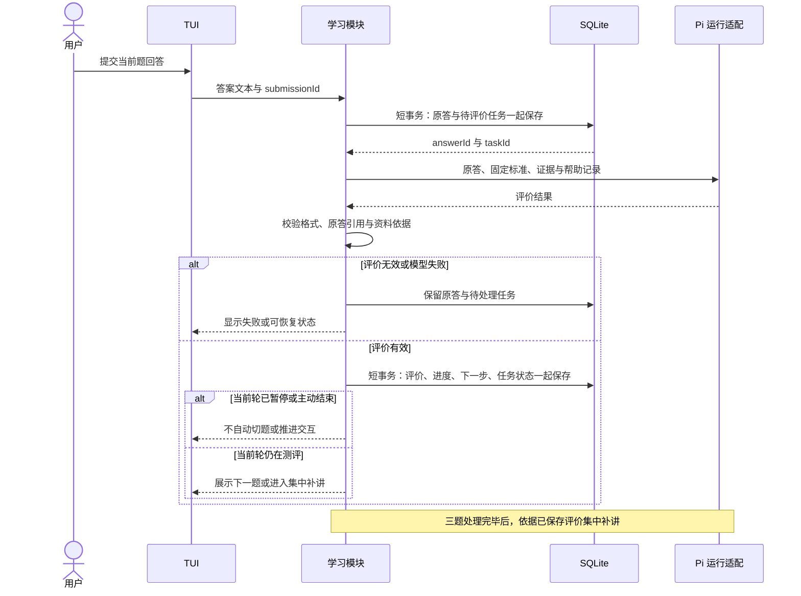
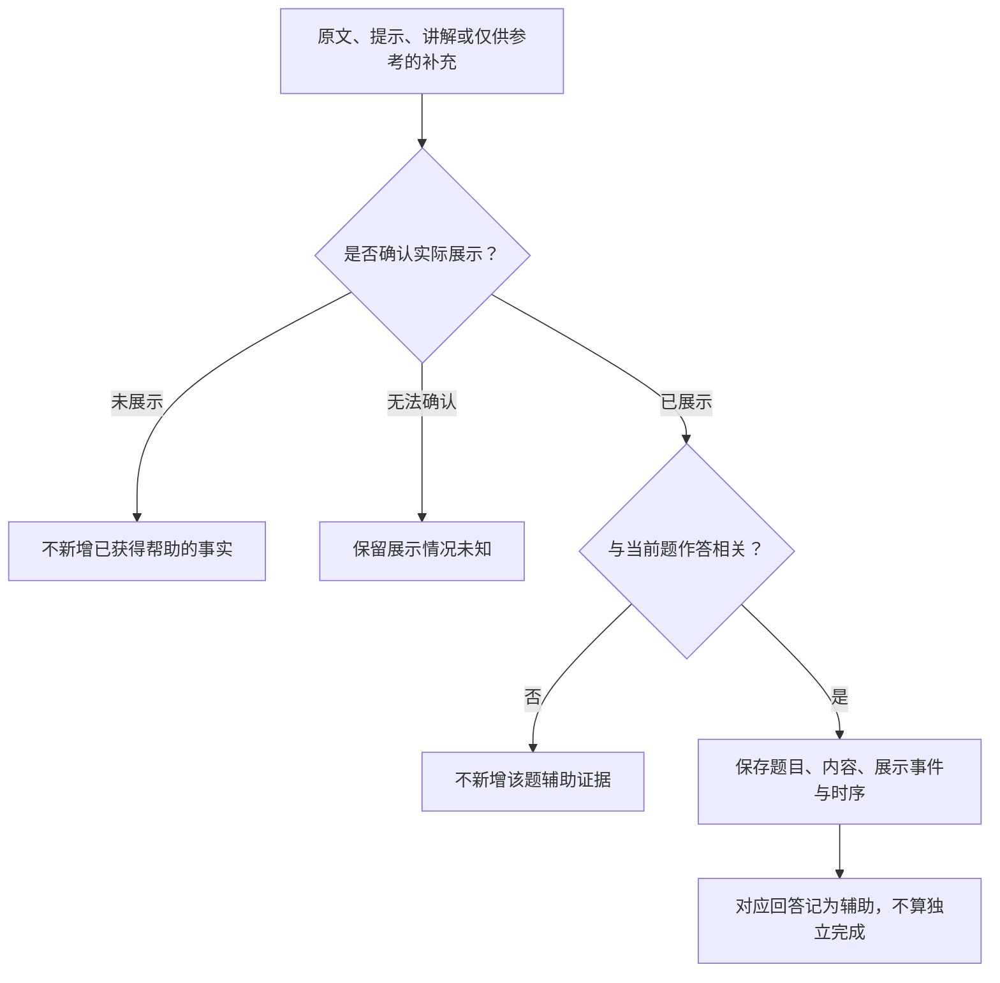
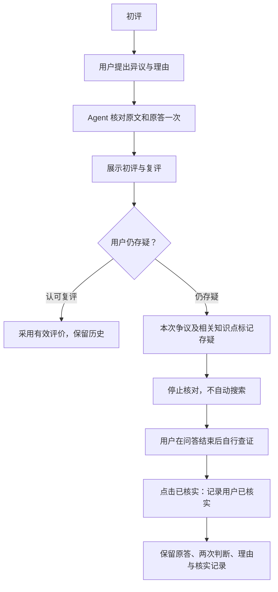
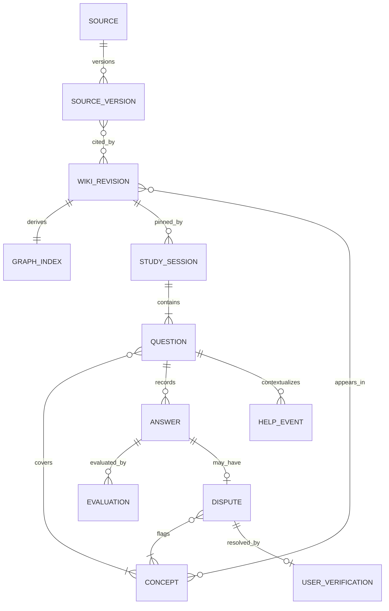
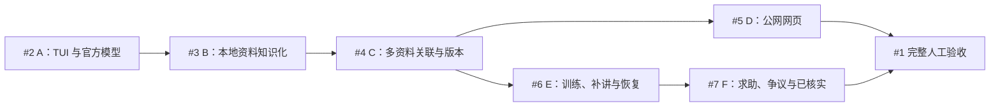

# Interview Helper 架构设计

> 更新日期：2026-11-12。本文记录首个可验收切片的已确认产品规则与技术方案，不代表功能已经实现。图中的模块、接口和数据关系是实现约束，不是现有代码或数据库表的清单。
>
> 总任务：[Issue #1](https://github.com/awu123-create/interview-helper/issues/1)。若旧 issue 仍描述训练期间导入、无限复核等行为，应按本文已确认的规则对齐。

## 1. 目标与首批边界

构建一个独立启动的本地面试学习 Agent：导入相关资料，形成带出处的知识网络，在多区域 TUI 中从一个具体知识点开始三题测评，随后集中补讲，并能在中断后继续。

- **交互**：资料/知识导航、对话和训练状态同时可见；首批在 macOS 终端验收。
- **资料**：Markdown、TXT、用户指定且可直接提取正文的公网网页。
- **模型**：通过 Pi SDK 接入官方 API。配置一个明确的提供方与模型，不自动切换计费渠道。
- **学习**：先完成三道主问题，再集中补讲；允许查阅与主动求助，实际展示的相关内容计为辅助。
- **知识更新**：自动整理、校验后整批生效；导入与训练串行。
- **争议**：最多一次逻辑复核；仍存疑就记录，用户自行查证后可标记“已核实”。

后续范围：跨知识点自由目标、PDF、Word、OCR、Magpie、浏览器知识图、报告导出、定时复测、简历与面试复盘。首批不主动联网搜索，也不提供总分、排名或掌握概率。

## 2. 总体架构与模块职责

一个 TypeScript / Node.js 本地进程承载 TUI、应用流程和 Pi 运行适配。SQLite 随应用使用；模块之间通过进程内调用协作，不增加 HTTP 后台、向量库、图数据库或多 Agent 编排。



- **TUI**：布局、焦点、输入编辑、滚动、流式显示和用户动作；显示领域状态，不自行判定答题完成。
- **应用用例**：检查能否启动导入或训练、路由提交/求助/暂停/恢复、接入持久化状态。重启后仍执行同样的规则。
- **知识模块**：保存来源快照、解析正文、提取并消歧概念、校验引用与关系、发布不可变修订、执行图查询。
- **学习模块**：固定训练范围与依据，管理三题、回答、评价、补讲、帮助记录和一次复核上限。
- **Pi 运行适配**：官方模型连接、专用工具、流式事件与上下文会话。模型提出内容，程序校验后才改变知识或学习事实。
- **持久化访问**：单写入锁、写入代次、迁移、外键、唯一约束和短事务；文件就绪与数据库切换分别处理。

首批技术基线：

- Node.js **22.23.4**、TypeScript、npm。
- `@earendil-works/pi-coding-agent` **1.5.2**、`@earendil-works/pi-tui` **1.5.2**。
- SQLite，使用 `better-sqlite3` **13.1.1**。
- Markdown 使用 mdast；TXT 直接分段；网页使用 jsdom 与 Readability。
- Wiki 使用 Markdown/YAML；图索引保存为 `graph.json`，首批由 TypeScript 查询。
- 应用验证使用 Node.js 内置测试框架；实现依赖由清单和锁文件固定。

### Pi 接入边界

使用 Pi 的通用 TUI 组件与 SDK，自行组织学习工作台。Pi 的完整 `InteractiveMode` 带有 Bash、登录和编码会话行为，其 `/resume` 也不是本产品的任务恢复语义，因此不直接作为应用外壳。

显式提供产品资源加载器、模型运行时、设置和会话目录，只启用已交付的专用工具。关闭 Bash、PowerShell、任意文件读写和 SQL 执行入口；资料中的文字是学习材料，不是运行指令。仅设置工作目录或 `agentDir` 不构成完整隔离。

提供方与 `modelId` 保存在本产品配置中。API key 只取所选提供方的环境变量，不读取其他工具凭据，也不进入知识内容、学习记录或日志。启动和查看状态不发起模型生成；模型不可用时明确失败，不落入 SDK 自动改选模型的路径。

## 3. 多区域 TUI

以下是区域职责示意，不固定具体列宽、断点或快捷键。

```text
┌────────────────┬──────────────────────────┬──────────────────┐
│ 资料 / 知识导航 │ 对话 / 当前问题 / 讲解   │ 训练状态         │
│                │                          │                  │
│ 已导入资料     │ 原回答、诊断追问         │ 当前题与进度     │
│ 概念与主题     │ 三题后的集中补讲         │ 待评价 / 暂停    │
│ 原文出处       │ 模型补充：仅供参考       │ 辅助 / 存疑      │
│                │                          │ 本次争议：已核实 │
├────────────────┴──────────────────────────┴──────────────────┤
│ 输入编辑与明确动作：提交答案 / 插问 / 求助 / 暂停 / 恢复     │
└─────────────────────────────────────────────────────────────┘
```

Pi TUI 提供 `TuiAltScreen`、`HStack`/`VStack`、`ScrollView`、`Editor`、`Markdown`、焦点与覆盖层能力。业务视图、动作语义及学习状态由本产品实现。

- 非焦点区域不能误处理输入；导航、换行和粘贴不等于提交答案。
- 中文输入与多行代码粘贴必须实测，不能只验证英文单行输入。
- 回看历史内容时保持阅读位置；新流式输出不能强制拉回底部。
- 窗口调整保留输入内容与焦点归属；退出时恢复终端模式。
- 隐藏评价标准不进入答题阶段可见的视图数据，也不能通过退出输出泄露。
- 导入进度、待评价、暂停、存疑等状态必须反映真实任务结果。

OpenCode 的多区域焦点与 Gemini CLI 的输入、滚动处理作为设计参考，不整体引入它们的编码 Agent 界面或内部依赖。

## 4. 导入与训练串行

新文章可能修订已有知识，因此成功发布完整新修订后才开始新一轮训练。已有训练先完成或由用户主动结束，才能导入；暂停或退出不等于结束。



图示强调串行与恢复约束。导入失败保留旧完整知识，但不视为该次导入完成，也不自动开始练习；读取旧知识与查看失败状态仍然可用。

主动结束保留原答、已有评价和事件，未完成题目保持未验证。应用停止当前执行并固定任务状态后，才开放下一项操作；迟到结果不能重新推进已结束或暂停的交互。

训练固定本轮目标、相关概念、三题、隐藏标准、资料版本和 Wiki 修订。新知识不得静默替换历史问题或评价依据。资料浏览及个人核实标记本身不启动新的导入或训练任务。

## 5. 来源、知识网络与整批生效

概念、主题、资料版本、关系与修订使用永久标识。文件名、标题和内容哈希不替代身份；哈希用于校验与重复检测。



- 原件与解析结果关联固定资料版本；引用定位到正文块及块内范围。恢复读取已存快照，不重新读取已变化的文件或网页。
- 三类节点为资料、概念、主题。关系明确类型、方向、条件、来源与判断状态；普通页面链接不自动生成前置知识关系。
- 跨资料确认同一概念后复用 ID；同名异义保持分开。无法确认的匹配保留候选状态，不强行合并。
- 结构或引用错误阻止整批发布。语义争议明确标记，不能成为确定判错依据；程序校验不能证明模型理解正确。
- 文件、索引和清单先持久化，再在 SQLite 内切换生效指针。SQLite 事务不声称能够原子提交文件系统。
- 切换前失败继续使用旧修订；切换后重放读取数据库完成状态，不重复启用。
- 正常重启加载已持久化索引，不调用模型或重建知识。索引缺失、损坏或版本不匹配时，从对应 Wiki 元数据重建，保持原节点与关系 ID。
- 同请求 ID、同内容返回已有状态；同 ID、不同内容报冲突。同源同内容重复导入不新增知识或模型调用。

### 网页输入边界

只抓取用户提供的公网 HTTP(S) URL，不主动搜索。初始地址及每次重定向都检查实际目标；最多 **5 次跳转、15 秒总超时、10 MiB 解压后大小**，不执行脚本。

登录页、验证码、空正文或提取失败不能冒充成功正文。网页适配复用同一快照、版本、发布及恢复流程，失败不损坏已有知识。

## 6. 三题测评、评价事务与补讲

用户从具体知识点开始，系统围绕有限相关概念确定本轮目标。资料不足以支撑三道有效问题时，说明缺少的依据并暂不开始，不以无来源内容凑题。

先保存三道主问题、隐藏评价标准与证据，再逐题展示。每题最多一次诊断追问；仍不明确就保留未判定。测评阶段默认不提前展示完整讲解或参考答案，主动求助单独记录。



判错必须引用原答片段和有效资料依据。资料不足、争议或未覆盖的答法不直接算错；模型补充必须标“仅供参考”，不能单独作为判错依据或自动写入 Wiki。

集中补讲是持久化的学习阶段，依据原回答、有效评价和本轮固定知识修订生成。补讲中断后继续当前阶段，不要求重答，也不把讲解生成当作用户掌握证据。

一轮结束后，TUI 按知识点与能力展示观察到的理解、缺口、独立或辅助作答、存疑项，并关联原答与出处。三题结果不直接推导长期掌握程度。

## 7. 查阅、求助与独立性证据



插问、查阅、提示、讲解和标记不熟都不是提交答案。只打开目录或模型生成了提示，不等于用户已经获得相关帮助；系统以可确认的 TUI 展示事实记录，不猜测用户是否读懂。

“仅供参考”只说明证据来源，不免除辅助记录。相关补充在作答前实际展示，同样影响独立性。帮助事件与题目、回答及展示时序关联；重绘、历史重放和上下文压缩不重复制造学习事实。

## 8. 一次复核、存疑与已核实



应用控制每次争议最多一次逻辑复核。技术重试与中断恢复复用原任务，不能成为第二轮语义复核。仍存疑时，这次评价不作为确定正误或掌握证据；其他题继续，其他有效学习证据保留。

**“已核实”作用于一条争议记录。** 用户自行查证后点击，记录个人核实状态，并同步相关知识点展示。同一知识点若还有其他未处理争议，仍显示存疑。

点击按钮不自动把旧回答判对、不标记掌握、不修改 Wiki、不触发模型调用，也不把“仅供参考”变成确定依据。它不会自动恢复争议评价作为确定正误证据的效力，个人学习状态仍只汇总可用证据。首批不要求额外填写备注或来源，不增加确认弹窗。用户找到新资料后仍走已有导入流程，新训练形成新的证据，不重开旧题复核。

## 9. 数据关系、目录与接口

下图表示逻辑关系，不是最终 SQL 表结构。知识身份、知识版本、学习证据与个人争议状态分别保存。



- `SOURCE_VERSION` 固定原件及正文位置；`WIKI_REVISION` 固定一批完整知识；`GRAPH_INDEX` 是可重建的派生索引。
- `CONCEPT` 的永久 ID 不随名称或路径变化；历史记录继续关联当时的版本。
- `STUDY_SESSION` 固定知识修订、目标和当前阶段；题目保存标准、证据和涉及概念。
- 原回答不覆盖；评价修订追加并保留替代关系。争议及用户核实状态属于个人学习记录。
- 题目可以尚无回答或帮助事件，已保存的回答也可以尚无评价；这些关系均允许零条，不创建占位学习记录。
- 任务、请求 ID、步骤唯一约束及写入代次保存在 SQLite。图中省略通用任务表和物理关联表，不省略这些持久化职责。

默认数据根目录为 `~/.interview-helper`，可用 `--data-dir` 指定。数据目录与启动目录、应用安装目录分开。

```text
数据根目录/
├── runtime/             产品配置与 Pi 会话；不保存 API key
├── state.sqlite         任务、学习事件、进度、ID 与版本关联
├── raw/                 不可变原件与网页快照
├── parsed/              正文块与出处定位
├── wiki/
│   ├── staging/         尚未生效的候选批次
│   └── releases/        不可变 Wiki 修订
├── graph/               按修订保存 graph.json 与索引元信息
└── logs/                诊断信息，不作为恢复或学习事实的依据
```

核心进程内接口沿用总任务的职责：

- `openWorkspace(dataDir)`：读取当前修订、学习状态及未完成任务，不调用模型。
- `importSource(kind, locator, requestId)`：固定来源快照并推进自动导入。
- `publishRevision(taskId, expectedRevision)`：校验文件、基准版本与写入者后整批切换。
- `queryKnowledge(revisionId, query)`：返回正文、节点、关系和出处。
- `startStudy(conceptId)`：检查串行条件，固定三题及当前完整修订。
- `submitAnswer(sessionId, questionId, text, submissionId)`：保存当前题原答及评价任务。
- `recordStudyAction(sessionId, action)`：记录帮助、暂停等非答题动作。
- `commitEvaluation(taskId, answerId, result)`：原子提交有效评价与进度。
- `resumeTask(taskId)`：从持久化检查点继续，或返回已完成结果。

一次复核和“已核实”是学习模块的明确用例，按本次争议记录更新；接口命名和物理 schema 在具体实现时给出，不新增通用 SQL 或任意写文件入口。

## 10. 一致性、恢复与验收

单写入锁避免多个进程同时修改数据；SQLite 写入代次拒绝失效进程的迟到提交。每次执行使用独立产物目录，短事务不跨越模型或网络请求。

同请求重放返回已有结果，同 ID 异内容报冲突。瞬时模型网络失败最多自动重试一次，不与 SDK 默认重试叠加成无限调用；逻辑复核上限独立于技术重试。

首批应用必须覆盖以下验收：

- **隔离**：不同工作目录使用同一数据；只加载产品资源与工具；第二写入者和失效进程被拒绝。
- **导入**：中文和代码定位、重复请求、同名异义、无效引用、网页失败及超限。
- **发布恢复**：暂存、文件就绪、切换前后分别中断，只出现完整旧版或新版。
- **索引**：正常重启不重建、不调用模型；损坏重建后 ID 与历史关联不变。
- **串行与版本**：未结束训练阻止导入；下一轮使用新修订；恢复原轮仍用原依据。
- **学习**：三题后补讲、一次诊断上限、原答先存、评价事务、暂停迟到结果、重复提交与恢复。
- **辅助**：未展示、实际展示、无关内容、展示未知及“仅供参考”内容分别验证。
- **争议**：一次复核、再异议不调用模型、已核实只处理本次争议、不改历史判分。
- **TUI**：macOS 下多区域、中文输入、多行粘贴、焦点、滚动、窗口调整与退出恢复。
- **端到端**：干净目录导入两份相关资料并覆盖公开网页，完成三题、求助、补讲及重启恢复，人工核对关系、诊断与出处。

应用实现后交付：

```sh
npm ci
npm run verify:offline
npm run verify:live -- --data-dir .artifacts/slice-1-live
```

这些应用验证入口目前尚未实现。离线测试使用固定资料与模型响应；真实验证须先明确官方提供方、模型和调用授权，并记录实际结果，不能用模拟通过替代。

回退保留原件、旧 Wiki、原答与评价历史；不兼容的数据版本拒绝写入，不能靠删除个人数据回退。备份必须同时包含 SQLite 与其引用的文件版本。

### 本文的可重复验证

```sh
node scripts/verify-architecture.mjs
git diff --check
```

文档脚本检查 Markdown 围栏，并用固定版本 Mermaid CLI 将全部图表实际渲染到系统临时目录，输出预览路径。它复用 macOS 已安装的 Chrome、Edge 或 Chromium；首次运行从 npm 获取渲染器，不向仓库安装应用依赖，不调用模型。

## 11. 子 issue 与交付依赖



[#5](https://github.com/awu123-create/interview-helper/issues/5) 与 [#6](https://github.com/awu123-create/interview-helper/issues/6) 可以并行开发；这是开发任务依赖，与应用运行时导入/训练串行不同。

- [#2](https://github.com/awu123-create/interview-helper/issues/2)：TUI 框架、资源和写入隔离、官方模型接入、macOS 验收。
- [#3](https://github.com/awu123-create/interview-helper/issues/3)：自动导入、知识导航、整批发布与导入恢复。
- [#4](https://github.com/awu123-create/interview-helper/issues/4)：跨资料消歧、永久 ID、资料更新与旧版本追溯。
- [#5](https://github.com/awu123-create/interview-helper/issues/5)：网页来源适配，沿用同一执行顺序和发布保证。
- [#6](https://github.com/awu123-create/interview-helper/issues/6)：知识点入口、三题测评、集中补讲、证据结果与恢复。
- [#7](https://github.com/awu123-create/interview-helper/issues/7)：辅助判定、一次复核、存疑与本次争议的“已核实”。

后续 issue 描述需统一回填自动导入、串行执行、查阅辅助、一次复核、“已核实”和“仅供参考”等已确认规则。尤其 #6 原有“训练期间更新资料”的人工场景，应改为验证导入阻止与下一轮版本切换。本文提交不等于这些 issue 已完成或描述已同步。

## 12. 复用依据与证据边界

以下源码和文档已用于选型；参考实现不是本产品已完成的功能。Pi 两个包的 1.5.2 发布元数据要求 Node.js >=22.19.0，与本方案运行版本相容；真实 TUI 体验与官方模型调用仍需在首批实现中验证。

- [Pi 1.5.2 TUI 公共导出](https://github.com/earendil-works/pi/blob/b4afdddf44e059c67ccf5097e5317d913521b470/packages/tui/src/index.ts)、[布局与输入说明](https://github.com/earendil-works/pi/blob/b4afdddf44e059c67ccf5097e5317d913521b470/packages/tui/README.md)。
- [Pi SDK 模型、工具和资源边界](https://github.com/earendil-works/pi/blob/b4afdddf44e059c67ccf5097e5317d913521b470/packages/coding-agent/docs/sdk.md)、[完整 InteractiveMode 的输入行为](https://github.com/earendil-works/pi/blob/b4afdddf44e059c67ccf5097e5317d913521b470/packages/coding-agent/src/modes/interactive/interactive-mode.ts#L3460)。
- [OpenCode 多区域 SessionFrame](https://github.com/anomalyco/opencode/blob/101776024cc69bafb3f9dc90027ab4d1eab40a2a/packages/tui/src/component/session-frame.tsx)、[焦点隔离 PanelHost](https://github.com/anomalyco/opencode/blob/101776024cc69bafb3f9dc90027ab4d1eab40a2a/packages/tui/src/component/panel-host.tsx)。
- [Gemini CLI 输入处理](https://github.com/google-gemini/gemini-cli/blob/aeb6c04b093eb00c33585ba587c4889ae4c5e957/packages/cli/src/ui/components/InputPrompt.tsx)、[滚动视图](https://github.com/google-gemini/gemini-cli/blob/aeb6c04b093eb00c33585ba587c4889ae4c5e957/packages/cli/src/ui/components/shared/Scrollable.tsx)。
- [Mermaid CLI 的 Markdown 渲染方式](https://github.com/mermaid-js/mermaid-cli#transform-a-markdown-file-with-mermaid-diagrams)。
